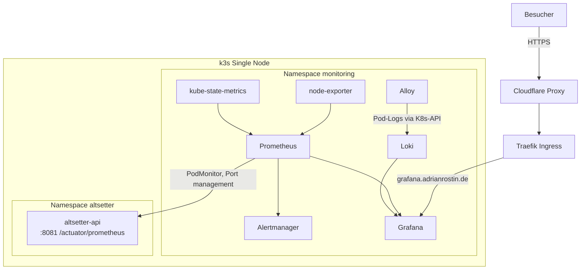

# cluster-monitoring

Monitoring-Stack für meinen k3s-Single-Node-Cluster: Metriken, Logs, Dashboards
und Alerting – alles als Code und per **Argo CD (GitOps)** verwaltet.

## Was ist drin

| Komponente | Zweck | Chart | Version |
|---|---|---|---|
| kube-prometheus-stack | Prometheus, Alertmanager, Grafana, node-exporter, kube-state-metrics | `prometheus-community/kube-prometheus-stack` | 93.3.1 |
| Loki | Logspeicher (14 Tage Aufbewahrung) | `grafana-community/loki` | 21.3.1 |
| Alloy | sammelt Pod-Logs (Namespaces `altsetter` + `monitoring`) über die Kubernetes-API | `grafana/alloy` | 1.16.0 |

Alles läuft im Namespace `monitoring`. Grafana ist unter
`https://grafana.adrianrostin.de` erreichbar (TLS per cert-manager, Login nur über GitHub).

## Architektur



Hinweis Datenschutz: **Traefik-Logs werden gar nicht eingesammelt** (keine
Zugriffsprotokolle). In allen übrigen Logs entfernt Alloy vor dem Speichern
IP-Adressen und Query-Strings (Suchbegriffe) – siehe unten.

## Voraussetzungen

- `kubectl` mit Admin-Zugriff auf den Cluster, `helm` (v3/v4).
- Namespace `monitoring` existiert (das Skript legt ihn sonst an).
- DNS `grafana.adrianrostin.de` zeigt (über Cloudflare) auf den Cluster.
- GitHub-OAuth-App (Homepage `https://grafana.adrianrostin.de`,
  Callback `https://grafana.adrianrostin.de/login/github`). Client-ID + Secret
  bereithalten – das Skript fragt sie ab.

## Installation

```bash
./install.sh
```

Das Skript ist idempotent und erledigt:

1. Namespace sicherstellen und Pod-Security auf `privileged` setzen
   (node-exporter braucht `hostNetwork`/`hostPID`/`hostPath`).
2. Secrets prüfen/anlegen: `grafana-admin` (zufälliges Notfall-Passwort) und
   `grafana-github-oauth` (Abfrage der OAuth-Daten). **Secrets kommen nie ins Repo.**
3. `helm upgrade --install` für die drei Charts mit den Values aus `values/`.
4. `kubectl apply` der Manifeste aus `manifests/` (PodMonitor, PrometheusRule,
   Dashboard, zusätzliche NetworkPolicy in `altsetter`).

Teilschritte: `./install.sh secrets|charts|manifests`.

## Login / Zugriff

- Grafana: **nur GitHub-Login**, kein Passwort-Formular, auch keine HTTP-Basic-Auth
  auf der API (`auth.basic.enabled: false`). Rollen: `adrian-rostin` = GrafanaAdmin,
  `jan-herzog` = Admin; `role_attribute_strict: true` → alle anderen werden trotz
  gültigem GitHub-Login abgewiesen. Weitere Nutzer: in `role_attribute_path` ergänzen.

### Notfallzugang (wenn GitHub-Login nicht geht)

Das Admin-Passwort steht im Secret `grafana-admin`:

```bash
kubectl -n monitoring get secret grafana-admin -o jsonpath='{.data.admin-password}' | base64 -d; echo
```

Login-Formular ist per Config deaktiviert. Vorübergehend aktivieren:

```bash
kubectl -n monitoring set env deploy/kube-prometheus-stack-grafana GF_AUTH_DISABLE_LOGIN_FORM=false
kubectl -n monitoring port-forward deploy/kube-prometheus-stack-grafana 3000:3000
# Browser: http://localhost:3000  (User: admin, Passwort: s. o.)
```

Danach wieder zurücksetzen:

```bash
kubectl -n monitoring set env deploy/kube-prometheus-stack-grafana GF_AUTH_DISABLE_LOGIN_FORM-
```

## Dashboards

- Standard-Dashboards des Charts (Kubernetes/Nodes) bleiben aktiv.
- **JVM (Micrometer)** – grafana.com ID 4701, wird beim Deploy geladen.
- **Altsetter API** (eigenes Dashboard, `manifests/dashboards/altsetter-api.yaml`):
  Requests/s nach URI & Status, Latenz (Ø/Max), 5xx-Rate, 429 (Rate-Limit),
  JVM-Heap, Threads, HikariCP-Pool, Pod-Restarts, Verfügbarkeit.

> **Zur Latenz:** `http_server_requests_seconds` wird von der API aktuell als
> *Summary ohne Buckets* exportiert → echtes p50/p95/p99 ist nicht berechenbar.
> Das Dashboard zeigt daher Durchschnitt und Max. Für echte Perzentile in
> `altsetter-api` aktivieren:
> `management.metrics.distribution.percentiles-histogram.http.server.requests=true`
> Danach funktioniert die auskommentierte p95-Regel in der PrometheusRule.

## Alerting

PrometheusRule `altsetter`: API nicht erreichbar (`up==0` > 2 min),
5xx-Rate > 5 % (5 min), Ø-Latenz > 1 s (10 min), Pod-Restarts (letzte Stunde),
Monitoring-Volume > 85 %. Alertmanager hat vorerst nur den `null`-Receiver
(ein Discord-Empfänger ist in `values/kube-prometheus-stack.yaml` auskommentiert vorbereitet).

## Datenschutz-Leitplanken

- **Keine Zugriffsprotokolle:** Traefik-Pods werden von Alloy nicht eingesammelt.
- **Log-Umfang:** Alloy sammelt nur `altsetter` + `monitoring` (Single Node: schont die inotify-Watcher der Node). Weitere Namespaces später, siehe „Nächste Schritte".
- **IP-Adressen** (IPv4 & IPv6) werden in Logs durch `<ip>` ersetzt.
- **Suchbegriffe:** Query-Strings (`?...`) werden durch `?<entfernt>` ersetzt.
- **Loki-Retention 14 Tage**, **Prometheus-Retention 15 Tage** (begrenzte Speicherdauer).
- Keine Metrik-Labels mit IPs/User-IDs/Suchbegriffen (Micrometer-URIs sind getemplatet).
- Grafana: kein Gravatar, kein Usage-Reporting, kein Self-Signup.

## GitOps (Argo CD)

Das Monitoring wird von **Argo CD** (Namespace `argocd`, v3.6.1) aus diesem Repo
verwaltet – privates Repo `github.com/adrian-rostin/cluster-monitoring`, Zugriff
über einen **read-only Deploy-Key** (SSH). Vier Applications
(`kube-prometheus-stack`, `loki`, `alloy`, `altsetter-monitoring-manifests`) mit
`automated`-Sync (`prune` + `selfHeal`).

**Änderungen laufen jetzt über Git:** bearbeiten → committen → `git push` → Argo
zieht sie automatisch nach. `install.sh`/`helm` sind nur noch fürs Erst-Bootstrap.
Details in `argocd/README.md`.

Argo-UI (kein Ingress, nur intern per Port-Forward):

```bash
kubectl -n argocd port-forward svc/argocd-server 8080:443
# Browser: https://localhost:8080  (User: admin)
kubectl -n argocd get secret argocd-initial-admin-secret -o jsonpath='{.data.password}' | base64 -d; echo
```

## Nächste Schritte

- Cloudflare Access vor `grafana.adrianrostin.de` (Allow-Liste E-Mail/GitHub).
- Discord-Receiver im Alertmanager aktivieren.
- Gatus als öffentliche Statusseite `status.adrianrostin.de`.
- Grafana Public Dashboards fürs Portfolio.
- Zwei Kolleg:innen per GitHub ergänzen (in `role_attribute_path`), später eigene
  Namespaces mit RBAC, ResourceQuotas, NetworkPolicies, Pod Security `restricted`.
- Perzentil-Histogramme in `altsetter-api` aktivieren (s. o.).
- Weitere Namespaces in Alloy aufnehmen (vorher `fs.inotify.max_user_instances`
  auf der Node `debian-k3s-01` erhöhen, sonst „too many open files").
- Satz für die Datenschutzerklärung: „Fehlermeldungen werden zur Fehlersuche
  zentral gespeichert (IP-Adressen und Suchbegriffe vorher entfernt) und nach
  14 Tagen automatisch gelöscht."
